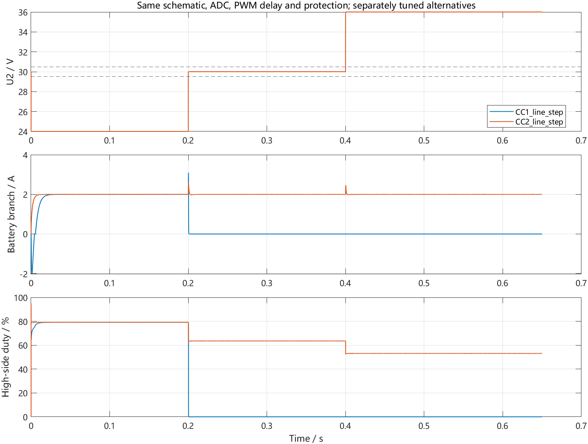
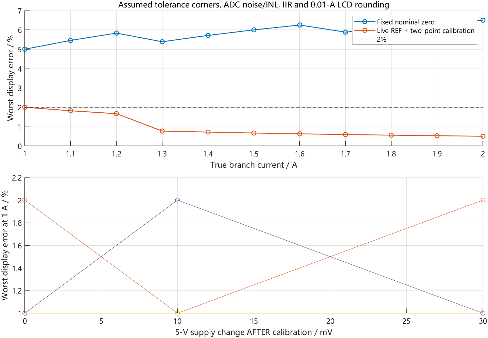
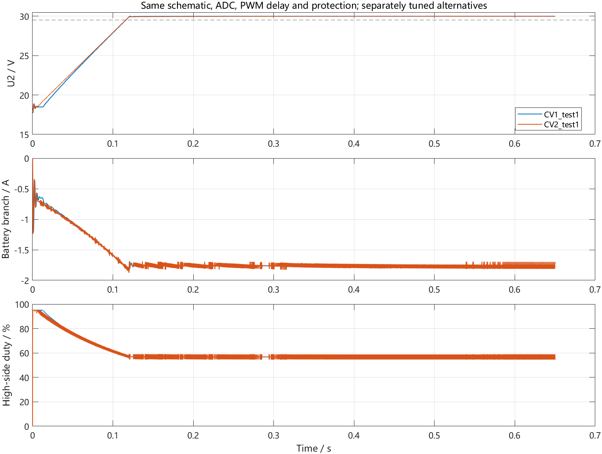
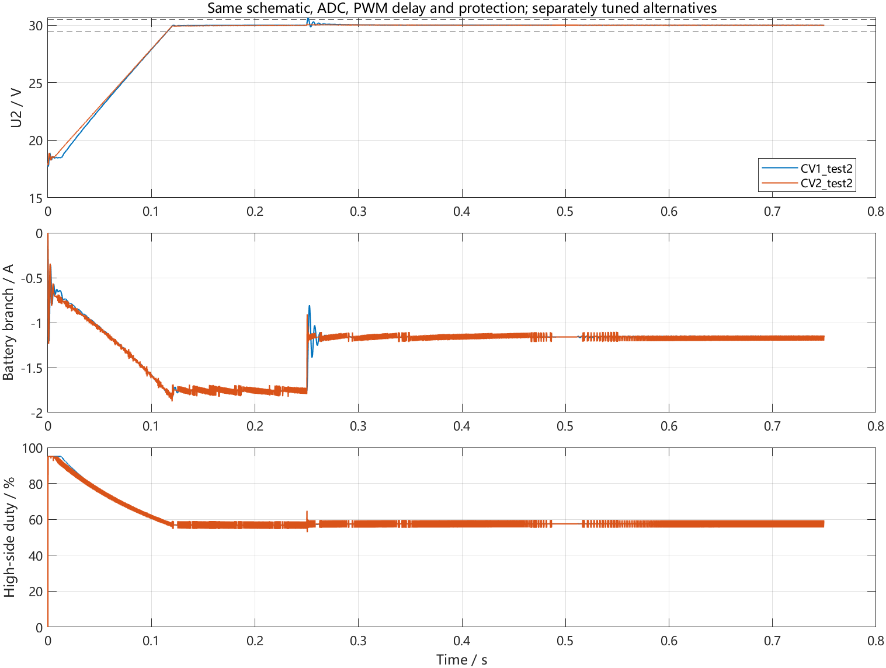
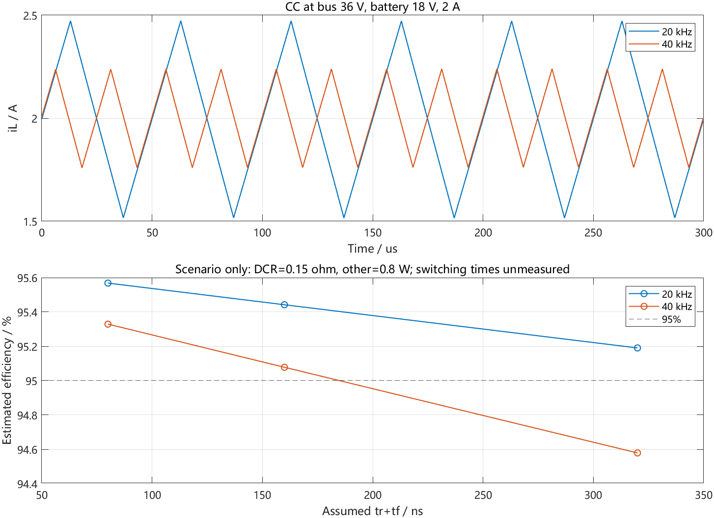
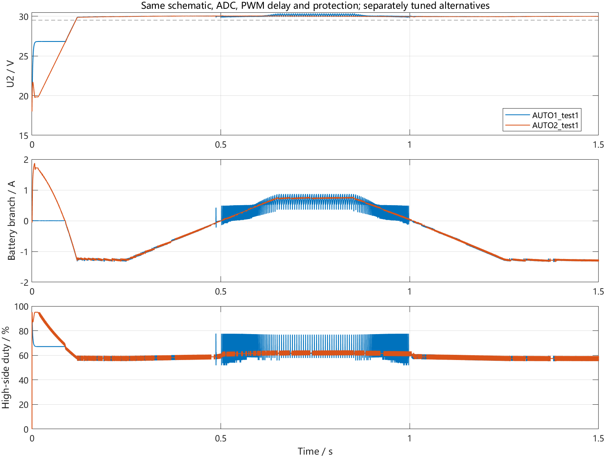
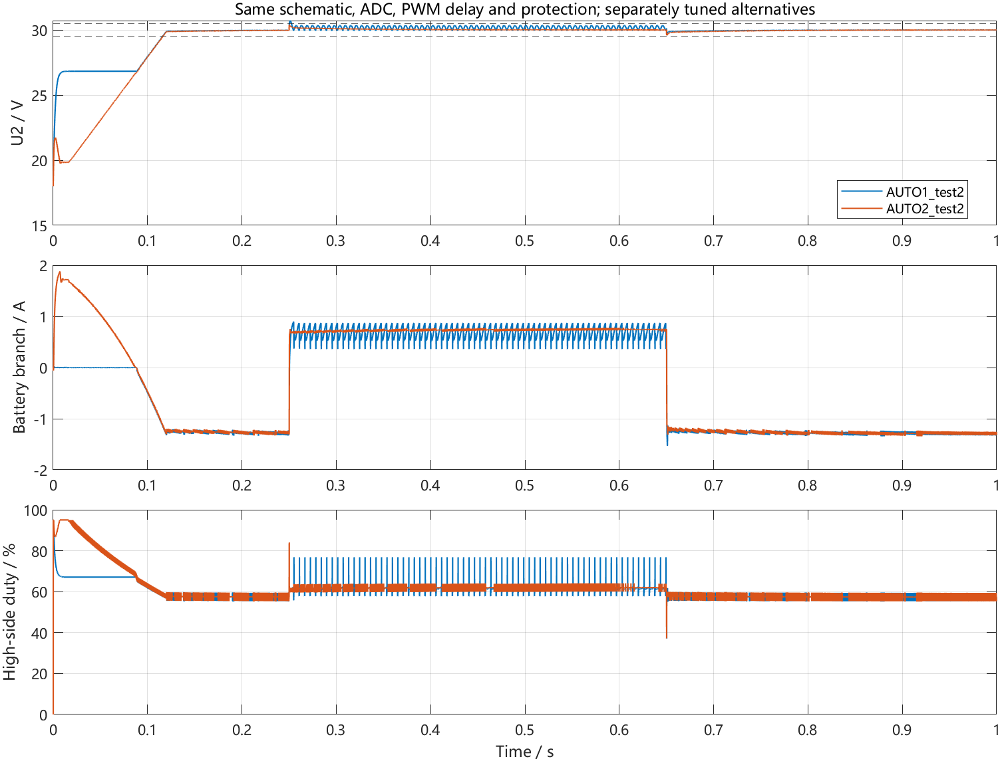

# 2015 A 双向 DC-DC：方案比较与决策说明

更新日期：2026-11-01（AUTO2突变响应与真实PWM/ADC时序更新）。按最新范围覆盖基本要求（1）～（5）和发挥部分（1）（2）。硬件沿用第二版原理图及STM32G474VET6最小系统板；旧PCB不在本次工作范围内。

## 1. 最终选择

| 项目 | 实际比较的方案 | 最终决定 |
|---|---|---|
| 基本（1）恒流、基本（2）输入变化率 | CC1：电流PI、启动工作点预置、运行无前馈；CC2：电压比前馈＋电流PI | 选CC2，两问共用一个电流控制器 |
| 基本（3）充电效率≥90% | 30V/2A同步BUCK下约20kHz与40kHz | 保留20kHz；用显式开关电路和损耗情景估算，实物待验收 |
| 基本（4）电流测量显示≤2%误差 | M1：固定名义零点；M2：实时REF＋两点标定，相同IIR与显示取整 | 选M2，标定残余零偏/增益，LCD显示0.01A |
| 基本（5）过充保护 | 直接验证越阈值停机、锁存、恢复条件 | 24V锁存停机，低于23V且人工停机后解锁；此问明确且简单，不凑第二种 |
| 发挥（1）稳压 | CV1：直接电压PI＋越限电流接管；CV2：电压外环/电流内环 | 选CV2，电流参考与限流关系明确，可复用CC内环 |
| 发挥（1）效率相关实现 | 原频率约20kHz与约40kHz，均跑显式开关模型和损耗敏感性 | 保留20kHz，ARR=4249；95%仍待实物验收 |
| 发挥（2）自动转换 | AUTO1：上下阈值切换CC/CV；AUTO2：连续带符号电流双环 | 选AUTO2，正常调压及容差下余量更大，过零不重置控制器 |

固件只保留所选算法及其四个PI增益。未选方案、试验状态和候选搜索不编入固件。

## 2. 公共条件与公平性

本机MATLAB R2023b实际运行。电路为470µH、两端各440µF、10mΩ分流器，电池端口默认18V/0.20Ω；电感DCR暂估0.15Ω、MOS等效通态电阻暂估0.015Ω。模型保留电池侧电容，因此反馈是**电池支路电流，不是瞬时电感电流**。含12位ADC、INA213名义增益偏差、电流滤波、PWM计数量化、PWM1谷值高电平、两次ADC逐路采样、谷值控制/峰值装载CCR和520ns死区。空母线接电池浪涌不在此稳压模型验收范围内。

各结构共用启停、保护和限幅。CC1启动也预置U1/U2工作点，避免把零占空比错误启动作为劣势；运行后不再更新前馈。单电压环独立搜索12组增益，原PI双环搜索8组，阈值策略搜索4个死区，均有CSV记录；这是有界工程比较，不是全局最优证明。结构比较共49组电路运行，频率比较另6组（包括新增30V/2A充电效率）；测量另有4种假设误差角、11档和2种方法。最终所选方案另执行完整回归、开关模型及C一致性检查。PWM/ADC事件依据工程配置建模，ISR计算耗时、采样保持孔径、器件传播延迟及寄生参数尚无实测辨识，不称为与实板完全等效。

自动正常调压：Us在32～38V以15V/s往返，D压降暂估0.7V、源串联5Ω、负载30Ω；稳定/动态统计从220ms后开始，启动单独看波形。本轮按用户要求把瞬间6V阶跃列为明确验收项；另保留15V/s扫描与30Ω→45Ω负载测试。

## 3. 基本（1）（2）：电流PI与电压前馈PI

| 方案 | 11档最大恒流误差 | 原题输入变化率 | 附加24→30→36V阶跃的iL峰值/状态 |
|---|---|---|---|
| 电流PI，运行无前馈 | 0.0591% | 0.001282% | 3.815 A / 过流锁存 |
| 电压比前馈＋电流PI（选） | 0.0609% | 0.000755% | 2.707 A / 无故障 |

11档为1.0～2.0A、每档0.1A。变化率严格按题目abs(I36-I24)/I30×100%计算。两种PI在稳态都通过。本次标定初值已补偿INA213两只实装10Ω输入电阻的名义增益影响，实物仍需基本（4）的两点标定。选择CC2的主要依据是输入变化时及时修正工作点；CC1在附加阶跃中触发电池支路过流后锁存，不能继续正常调节。CC2附加阶跃的最大实际电池电流误差约0.582A，不能把稳态变化率理解为瞬间误差也小于1%。

CC2输入阶跃的电感峰值约2.707A。现有电感标称电流资料不能证明Isat达到此值；软件±2.8A检测的是电池支路，不能代替电感峰值保护。此附加工况须在实际电感饱和/温升校核后再上电验证。

以上11档为平均模型统计。本轮闭环开关模型已按两次ADC逐路采样与DMA完成时刻运行，另对1A/2A开关波形复核显示。周期平均实际电流的控制误差最大约0.617%，仍≤5%，但大于平均模型误差；详见`结果/基本14_开关波形采样与显示复核.csv`。不将平均模型很小的误差当成实物精度。



## 4. 基本（3）：充电效率≥90%

在U2=30V、I1=2A、18V电池模型下，分别运行约20kHz和40kHz的显式开关BUCK。母线输入功率与电池端输出功率按各RK4积分阶段积分，避免在栅极跳变处离散取样造成输入功率偏差。效率按原题η1=P1/P2计算，独立辅助供电的栅极功耗另列。

| 频率 | 电池端输出功率 | 主端口损耗情景 | 充电端口效率情景 |
|---|---|---|---|
| 20.0047 kHz | 36.680 W | 1.628 W | 95.751% |
| 40.0000 kHz | 36.773 W | 1.751 W | 95.456% |

上述情景DCR=0.15Ω、tr+tf=160ns、其他主端口损耗0.8W；36种充电损耗情景见`方案对比/结果/基本3_两频率充电效率_非实测.csv`。两频率均给定2A，但实际逐路采样下周期平均电流略不同，表中保留各自实际模型功率。保留20kHz的依据是当前电感已有可用纹波，同时降低频率相关损耗。模型估算通过不等于真实≥90%，还需实测两端功率、DCR、开关波形及温升。保持同步整流，不增加无电感过零采样支持的二极管模拟模式。

## 5. 基本（4）：电流测量与LCD显示

M1用固定名义零点和2A/V；M2在每帧扣除REF，再用真实零电流与已知2A时的I/REF平均码标定残余零偏和增益。两者使用相同2kHz IIR和LCD 0.01A四舍五入。比较中给校准电流表加入±0.1%误差，I与REF各加入3计数RMS噪声和±2计数平滑INL；4组静态角包含分流器±5%、放大器假设±1%、REF偏差和ADC参考偏差。它们是设计敏感性情景，**不是器件实测或覆盖一切误差的上界**。每档评估稳定后的所有可能LCD取样相位，较只取一个刷新时刻保守。

| 方案 | 最大平均换算误差 | 含LCD取整的最大误差 |
|---|---|---|
| 名义系数直接换算 | 6.014% | 6.500% |
| 实时REF＋两点标定（选） | 0.482% | 2.000% |

选择M2：实时REF扣除公共偏置漂移，两点标定处理残余零偏和增益误差。四组假设情景的显示误差不超过2%（包含边界），仍须实物标定。标定后5V变化30mV的本轮情景，1A附近最差显示误差约2.0%，不代表已覆盖开关尖峰或异步采样误差。`calibrate_current(NI0,NR0,NI1,NR1,Ical,Vadc)`输出两行宏，不自动写文件、不带电学习零点。

当前固件使用实时REF＋`ADC_CURRENT_OFFSET_RAW`残余零偏＋`ADC_CURRENT_A_PER_PIN_V`增益；2.017A/V为两只实装10Ω的理论名义修正，实物残余零偏和增益须台架标定。滤波后的实测电池电流用于LCD，100ms刷新，显示两位小数，不以设定电流冒充测量值。

另在1A/2A实际开关波形上回放每周期两次ADC与现有IIR，稳定后所有相位的0.01A取整显示，相对真实周期平均电流最大误差约0.621%，通过所设2%检查。此项是显示链波形回放；模拟噪声/静态误差角和开关纹波分别验证，最终仍由电流表验收。



## 6. 基本（5）：明确的锁存过充保护

此问不需要两套控制架构。采用题目串滑阻抬高端口U1的方式，所选方案约在24.0016V触发。关断SD#及PWM输出，电压回落也不自动恢复；低于23V且人工停机才解锁。八项保护逻辑检查及生成C对照覆盖锁存、复位、双向过流、欠压、母线过压和无效输入。24V是端口试验阈值，不能据此给五串普通锂电芯充到24V。

## 7. 发挥（1）：稳压结构及频率

单环独立整定为Kp=0.020占空比/V、Ki=0.600占空比/(V·s)。最终双环增加电流反馈相位超前与参考变化前馈，使用当前头文件的四个增益。单环保留越限电流接管和同一硬过流保护，并非无保护的理想电压源。

| 方案 | 18V电池稳态偏差 | 附加30Ω→45Ω负载变化最大偏差 | 15.5V电池稳态偏差 |
|---|---|---|---|
| 电压单环 | 0.0045 V | 0.6217 V | 0.0091 V |
| 电压/电流双环（选） | 0.0133 V | 0.1329 V | 0.0157 V |

两者启动进入±0.5V所需时间均约116ms，主要由100V/s母线给定斜坡决定，不能宣称双环启动更快。双环在本次负载变化中偏差较小，也把充放电电流给定限制写在同一内环接口中，故选CV2。单环同样可实现稳态指标，未被认定为不可行。

| 频率 | 36V/18V/2A时iL纹波p-p | 端口效率情景估算 | 独立辅助供电栅极损耗估算 |
|---|---|---|---|
| 20.0047 kHz | 0.960 A | 95.442% | 0.058 W |
| 40.0000 kHz | 0.483 A | 95.078% | 0.117 W |

频率表的效率是假定DCR=0.15Ω、tr+tf=160ns、其他**主端口相关**损耗0.8W的情景值。完整CSV还扫描DCR=0.05/0.15/0.30Ω、tr+tf=80/160/320ns、其他端口损耗0.2/0.8W，充/放电各36种损耗情景。40kHz纹波更小，但在上述情景下增加开关及死区损耗；20kHz的稳压和纹波已有可用仿真结果，故保留20kHz。未测磁芯损耗、ESR、开关波形可能改变最优频率，**不宣称20kHz为实物全局最优或95%已经达标**。

效率口径按原题η2=P2/P1。独立辅助电源提供的栅极能量不加到电池主端口P1中；另列栅极功耗与计入该项的保守效率，便于看整体代价。Pg=2QgVgsf，Qg暂取数据手册146nC、Vgs取10V的情景值；该测试点不是本板2A实测值。开关重叠损耗近似0.5·U2·|iL|·(tr+tf)·f。30W、95%对应主端口总损耗预算约1.579W，最终须用端口实测功率验收。





## 8. 发挥（2）：阈值切换与连续双向控制

AUTO1独立选择的半死区为0.05V：母线过高切1A恒流充电，过低切30V恒压放电，中间保持模式。AUTO2的电压环直接给出正负电流，正值充电、负值放电，过零无需重置积分器。

| 工况 | AUTO1最大母线偏差 | AUTO2最大母线偏差（选） |
|---|---|---|
| 18 V，15 V/s往返调压 | 0.3466 V | 0.0775 V |
| 15.5 V，L/C各-20% | 0.5367 V | 0.1007 V |
| 21 V，L/C各+20% | 0.2210 V | 0.0706 V |
| 附加：Us瞬间32/38V往返 | 0.7165 V | 0.4148 V |

正常18V往返调压，AUTO1发生426次CC/CV转换，AUTO2保持统一自动模式，方向由电流参考连续过零决定。AUTO1在低电池电压/小L/C下超过±0.5V；AUTO2在比较表及完整容差复核下保留更大余量。所选方案正常往返确有充、放电，平均模型分别达到约0.774A与-1.342A。

**本轮突变结果：** 旧AUTO2在相同真实时序平均模型下偏差约1.446V；只提高PI约0.988V。所选方案增加参考变化前馈与电流反馈相位超前，标称18V电池、L=470µH、两端440µF，三个扰动PWM相位的显式开关模型范围为29.5565～30.4172V，最大偏差0.4435V，通过±0.5V。升、降两个方向及积分过程中的开关纹波都计入。

**容差边界：** 15.5/18/21V电池、L与电容组分别取0.8/1/1.2倍共27组平均模型（Cbat与Cbus使用同一倍率，并非两只电容分别独立扫描），最大偏差0.764V，未全部通过。最差角的开关复核偏差0.790V。不能宣称所有容差组合已通过；实板若接近这些边界，需测得实际L/C、内阻与采样延迟后再整定。

根因与补偿：旧3000A/s参考斜率使约2A方向转换至少耗时0.67ms；1.2A母线电流差在440µF上积累，形成明显偏差。由电感方程得到参考变化前馈，采用有效系数235µH（标称L的一半，不是把真实电感改成235µH）。电流反馈超前150µs，参考依据为(Rb+Rshunt)Cbat约92µs与IIR低频延迟约68µs之和。实际反馈仍是R4电池支路电流。四个PI增益仍属于工程整定结果，未完成严格频域裕度设计，不声称由完整自动控制理论推导得到。

不能只看电压峰值：Kpv=14候选虽然电压峰值较小，但周期摆动明显，未采用。最终Kpv=10；标称开关模型末100ms电池支路电流标准差不超过0.0207A，参考标准差不超过0.0535A。验收脚本另加0.1A支路标准差和0.2A参考标准差的工程筛选线（不是赛题指标），用于拒绝靠大幅极限环摆动压住电压的参数。

下面四组使用相同标称功率级、真实配置时序的平均模型；末100ms统计摆动，显式开关复核另见上方最终验收范围。

| 突变方案 | 最大电压偏差/V | 支路电流标准差/A | 参考标准差/A | 电压及摆动筛选 |
|---|---|---|---|---|
| 旧AUTO2 | 1.4460 | 0.0018 | 0.0056 | 未通过 |
| 仅提高PI | 0.9877 | 0.4883 | 1.3329 | 未通过 |
| 偏激外环候选 | 0.3714 | 0.2252 | 0.5515 | 未通过 |
| 所选AUTO2 | 0.4152 | 0.0215 | 0.0554 | 通过 |

详细波形见[09突变图](../../结果/AUTO2_32至38V突变.png)，复现入口`verify_auto2_transient`。



## 9. 最终代码与人工调参

唯一算法源为[dcdc_step.m](../../程序/dcdc_step.m)。CC使用I*=充电设定；CV/AUTO使用I*=限幅(Kpv·(U2-U2*)+积分)。CV限制在[-2.5,0]A，AUTO在[-2.5,+2]A。内环为If=I+Tlead·ΔI/Ts，dH=限幅((U1+Lff·ΔI*/Ts)/U2+Kpi·(I*-If)+积分)，占空比5%～95%；有抗积分饱和、模式初始化及CCR预装载时序。代码由本机MATLAB Coder生成，不手工改生成C。

| 人工参数 | 最终默认值 | 单位 |
|---|---:|---|
| DCDC_CURRENT_KP | 0.020 | 占空比/A |
| DCDC_CURRENT_KI | 8.0 | 占空比/(A·s) |
| DCDC_VOLTAGE_KP | 10.00 | A/V |
| DCDC_VOLTAGE_KI | 120.0 | A/(V·s) |
| DCDC_CURRENT_SLEW | 40000 | A/s，已有参考变化率限制 |

默认值只在[control_settings.h](../../../BUCKG474VET6_2/Core/Inc/control_settings.h)集中维护；RAM在线调整仍只有control_gains的四个PI增益。当前Kpi=0.02意为误差1A贡献2个百分点占空比；Ki按秒定义，函数内部乘周期。电流零点、两点增益和电压比例仍在adc_calibration.h。没有新增候选编号、实验开关或调试许可变量。台架起步可把已有current_slew降回100A/s，先做标定及低功率电流环，确认稳定后逐步提高；这会改变动态结果，应重跑仿真。

| 需求/决定 | 算法、硬件接口与验证文件 |
|---|---|
| CC2、CV2、AUTO2 | 仿真/程序/dcdc_step.m → Core/Generated/dcdc_step.c |
| 四个PI默认值、变化率与保护阈值 | Core/Inc/control_settings.h；Core/Src/app_control.c初始化读入 |
| ADC及电流方向 | Core/Src/app_adc.c；Core/Inc/adc_calibration.h；PC1母线采样 |
| 基本（4）标定和显示 | 仿真/calibrate_current.m；adc_calibration.h已有两个常数；app_lcd.c实测IBAT两位小数 |
| 24V锁存与实际关断 | dcdc_step.m故障状态；app_control.c拉低PB0并关MOE |
| 20.0047kHz | Core/Src/tim.c及.ioc：170MHz、中心对齐、ARR=4249 |
| 比较证据 | 方案对比/结果/*.csv、*.mat、*.png、*.fig |
| 机器可读对应关系 | 方案对比/决策与代码对应.json，含源文件和默认参数SHA256 |

## 10. 复现、已验证事项与实际边界

在本目录运行MATLAB：

```matlab
run_scheme_comparison  % 重跑候选、结构比较、频率比较；不改固件默认值
run_all                % 按当前人工默认值回归、生成C、验证并同步到工程
```

Keil再Rebuild。当前交付已实际执行当前回归与方案比较：Keil 0错误、0警告，生成C与MATLAB 20,000步对照最大绝对差0，所有生成C/H与工程副本相同。**未烧录，默认上电停机。** 重现入口不会把未选方案放入工程。原PI候选整定是固定有限集合，当前默认以AUTO2突变验收为依据，今后人工改变增益不等于需自动改选架构。

基线BUCKG474VET6-v1.zip未改，SHA256：`36AE2BE2309EECD10FFC11704B263FD11C52101B7A472AFD2E483142E013D583`。过期过程备份已清理，当前代码与验证证据保留。

第二版最终连接核查已完成：BOM、去耦、跟随器和采样/功率网分离已修正。正常量程采用5V供电且不加额外0.6分压，REF接PC0；异常过压与掉电时序仍是原型限制。实际标定、Isat/DCR、MOS尖峰、效率与温升待测。当前接线见[当前硬件说明](../../硬件核查/当前硬件说明.md)。

资料依据：芯片测试条件和损耗公式已核对[Infineon IRF3205数据手册](https://www.infineon.com/assets/row/public/documents/24/49/infineon-irf3205-datasheet-en.pdf)、[TI MOSFET损耗说明](https://www.ti.com/lit/an/slyt664/slyt664.pdf)、[TI栅极供电损耗说明](https://www.ti.com.cn/cn/lit/pdf/slua958)。各方案优劣由本机仿真数据推得，不把参考设计当成本板实测。
